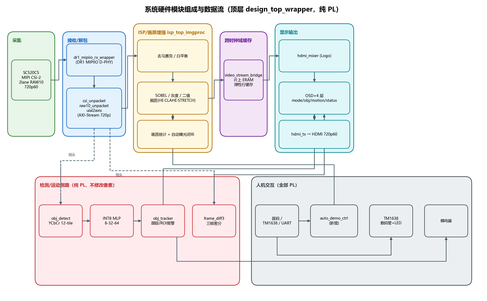
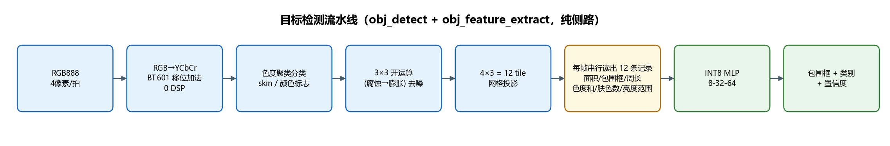
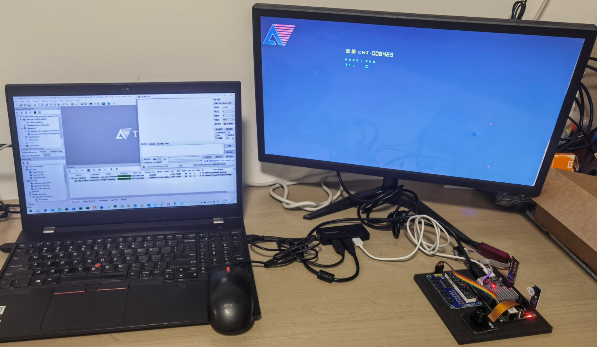

# FS03_DR1V90GEG_img_process_create2_sc520

> **基于安路（Anlogic）DR1V90GEG484 FPGA 的纯 PL 实时视频图像处理与目标识别工程**
> —— MIPI CSI-2 摄像头采集 → ISP/画质增强 → 64 类目标识别（INT8 MLP）→ 运动检测 → HDMI 实时显示，全链路 720p60。
> 片上**无处理器（PS）、无 DDR、无处理器软件**；模型训练与量化验证在 PC 侧 Python 完成，训练得到的权重以 ROM 形式固化进比特流。

---

## ✨ 项目亮点

- 🎯 **实时 64 类目标识别**：纯硬件 INT8 MLP（8→32→64，argmax），每帧最多输出 12 个包围框；推理结果与 Python 黄金模型**逐位一致（bit-exact）**。
- 🟦 **光照鲁棒的目标检测**：BT.601 整数 YCbCr 变换分离亮度/色度，仅用移位与加法（**0 个 DSP**），光照变化不影响检测。
- 🏃 **三帧差分运动检测**：片上 ERAM 实现 16×16 栅格运动热力图 + 外接矩形框 + 入侵报警（蜂鸣器）。
- ⚡ **纯 PL（无 PS）设计**：移除 PS 硬核、以太网桥与 4 个 PS 占位引脚，工程更简洁、跨时钟域更少。
- 🔁 **UART 备份切换**：PC 通过 115200 8N1 短字符串命令（`K1`~`K4`、`DEMO`）即可 100% 复现所有物理按键功能。
- 🤖 **自动演示巡检（Auto-Demo Patrol）**：`DEMO` 命令一键自动轮巡全部画质/阈值组合，TM1638 LED LED指示。
- 📊 **资源与时序均衡收敛**：各资源占用率 12%~36%，无任一项接近占满；时序裕量 SWNS +0.117 ns / HWNS +0.029 ns。

---

## 1. 工程概况

| 项 | 内容 |
| --- | --- |
| 开发板 | 米联客 **FS03 / 安路 DR1V90GEG484**（DR1 系列，484 脚 BGA） |
| 输入 | SC520CS **MIPI CSI-2** 摄像头（2 lane，RAW10，板载 lane clock 480 Mbps），**1280×720@60** |
| 输出 | **HDMI 1280×720@60**（安路 HDMI TX IP，RGB888，像素时钟 75 MHz） |
| 顶层 | `design_top_wrapper` —— 纯 PL 实现 |
| 赛题类型 | 自主赛题 |
| 主时钟 | 25 MHz 晶振 → `pll_main`(100/75/375 MHz) + `pll_cam24m`(24 MHz) |
| 位流 | `prj/fs03_img_process_create2_sc520_Runs/phy_1/fs03_img_process_create2_sc520.bit`（3.86 MB） |

> 本工程为纯 PL 实时视频图像处理与目标识别，外设仅使用 TM1638 数码管+LED+按键模块、小拨码开关、有源蜂鸣器与 UART，未使用其它外设。

---

## 2. 系统硬件模块组成与工作流程

顶层 `design_top_wrapper` 把视频主链路、检测/运动侧路、人机交互外设与时钟/复位全部在 PL 内完成：



### 主要硬件模块

| 模块 | 作用 |
| --- | --- |
| `dr1_mipiio_rx_wrapper` | MIPI D-PHY RX（2 lane，DR1 原厂 MIPIIO IP） |
| `csi_unpacket_2lane` / `raw10_unpacket_2lane` / `uial2axis` | CSI-2 / RAW10 解包 → AXI-Stream（40 bit 原生总线） |
| `isp_top_imgproc` | 去马赛克、白平衡、Sobel/灰度/二值、画质增强、画质统计、自动曝光 |
| `video_stream_bridge` | 片上 ERAM 弹性行缓存（取代 DDR2 三帧乒乓） |
| `hdmi_mixer` / `uivtc` / `hdmi_tx` | Logo 叠加、视频时序、TMDS 发送（75/375 MHz） |
| `osd_mode/obj/motion/status_overlay` | 四层 OSD：模式+阈值 / 目标框+类别+轨迹+ROI / 运动热力图 / 12 行状态 |
| `obj_detect` / `obj_feature_extract` / `mlp_classifier` | YCbCr 12-tile 检测 + INT8 MLP 分类（纯侧路，不修改像素） |
| `obj_tracker` | 跨帧时间投票跟踪、ROI 报警（NOBJ=2，NTRK=2） |
| `frame_diff3` / `motion_eram` | 三帧差分运动检测（16×16 栅格热力图） |
| `tm1638_led_key` / `uart_cmd_rx` / `uart_report` / `auto_demo_ctrl` | 人机交互：数码管+LED+按键、UART 命令/上报、自动演示巡检 |

### 工作流程

1. **采集**：SC520CS 经 2-lane MIPI 输出 RAW10@720p60，D-PHY 接收并解包为 AXI-Stream 视频流。
2. **ISP / 画质增强**：去马赛克、白平衡、Sobel/灰度/二值（SW1/SW2/SW3 独立开关）、画质增强（KEY3 选档），并实时统计亮度驱动自动曝光闭环（每 8 帧下发一次曝光/增益）。
3. **缓存/跨时钟域**：视频流经片上 ERAM 弹性行缓存，从 CSI 域跨到 HDMI 像素域（75 MHz）。
4. **检测 / 运动（侧路）**：同一路 RGB 被 `obj_detect` 抽头做 12-tile 检测、`frame_diff3` 做三帧差分；检测结果由 `obj_tracker` 跨帧投票稳定后送入 OSD 与报警逻辑。
5. **显示**：`hdmi_mixer` 叠 Logo → 四层 OSD 叠加 → `hdmi_tx` 输出 720p60。
6. **人机交互**：拨码开关、TM1638 按键、UART `K1`~`K4` 与 `DEMO` 汇入同一条 PL 控制通路（10 ms 消抖、1 s 延迟生效）。

---

## 3. 目标检测算法特点与运行流程

目标检测为**纯侧路（side path）**：抽头同源 RGB 流、从不修改任何像素，因此基础层与画质层行为不受影响，主链路端到端延时不变。

### 3.1 检测流水线（`obj_detect` + `obj_feature_extract`）



**算法特点（真实实现）**

- **YCbCr 而非 HSV/RGB 阈值**：Y 与色度（Cb/Cr）分离，光照变化主要移动 Y、几乎不动 Cb/Cr；HSV 需每像素 max/min 与除法，代价高一个数量级。
- **3×3 开运算（先腐蚀后膨胀）**：删除传感器噪声产生的孤立单像素（否则每个 tile 都会开一个假框），再膨胀恢复团块尺寸；代价仅 2×2.56 kbit 行缓存。
- **12 个独立 tile（4 列 × 3 行）**：单帧整体投影只能返回 1 个框；12 tile 每帧最多给出 **12 个候选框**，代价仅 12 组累加器且无额外数据通路；同一 tile 内不同颜色的物体即使相接触也不会被合并。
- **定点整数、零除法**：整条检测/分类链路全部用移位与加法，不出现任何除法（置信度来自小比较表）。

### 3.2 分类器（`mlp_classifier`）

- **网络结构**：输入 **8** 个 uint8 特征 → 隐藏 **32** 神经元（ReLU，INT8 重量化）→ 输出 **64** 类（argmax）。
- **定点整数推理**：权重 8 bit、偏置 16 bit；每个目标 **2304 次乘加（MAC）**；单比特串行 MAC 单元，`USE_DSP=1` 时由 DSP 硬核完成乘加（本工程占用 30 个 DSP）。
- **确定性 & 可复现**：权重与自检 testbench 由同一脚本同源生成，RTL 推理与 Python 黄金模型**逐位一致**。
- **功耗优化**：仅在乘法真正执行时才翻转累加器与 ROM 地址（`GATE_ACC=1`），降低动态功耗。

### 3.3 运动检测（`frame_diff3` + `motion_eram`）

三帧差分 + 片上 ERAM 缓存，生成 16×16 像素栅格运动热力图（半透明红块），外框为整块运动区域外接矩形，带入侵报警。

### 3.4 跨帧跟踪（`obj_tracker`）

时间投票稳定目标框（NOBJ=2，NTRK=2，`GATE=96`，`MAX_MISS=8`），在 HDMI 域做 ROI（540,300,200,140）入侵判断，命中驱动蜂鸣器（带消抖）。

---

## 4. 算法运行结果

### 4.1 硬件在板运行结果（实测）

| 项目 | 结果 |
| --- | --- |
| 吞吐 | 输入/输出全链路 **720p60（60 fps）** 实时处理 |
| 端到端延时 | **亚帧级（约十几行，≈0.3 ms）**，`latency_meter` 以 0.1 ms 分辨率实测 |
| 目标检测 | 每帧最多 **12 个包围框**（4×3 tile），每框给出 64 类之一及置信度 |
| 运动检测 | 16×16 栅格热力图 + 运动外接矩形，实时标记 |
| ROI 入侵报警 | 目标进入 ROI 窗口即触发有源蜂鸣器（带消抖） |
| 自动曝光 | 曝光 64~1125、增益 16~176、目标亮度 118，每 8 帧（≈133 ms）闭环一次 |
| 状态可视化 | OSD 12 行状态（帧率/延时/类别/置信度/ROI/亮度/曝光/增益/报警），TM1638 数码管显示阈值 |

### 4.2 软件运行结果（Python 黄金模型，实测复跑）

权重训练/量化脚本 `train_mlp.py`（NumPy，固定随机种子：数据 `20260921`、训练 `7`，结果可复现）。以下为在 **Python 3.10 + NumPy 2.2.6** 环境下的实际复跑输出：

| 项目 | 结果 |
| --- | --- |
| 网络几何（从 RTL 回读） | CLS_W 6，NIN 8，NH 32，NOUT 64 |
| 数据集（合成特征模型） | 训练 64 000 样本（64 类 × 1000），测试 19 200 样本（64 类 × 300） |
| 训练配置 | Adam，batch 256，1600 epochs，lr 0.03 指数衰减 |
| 训练精度 | epoch 1 = 94.99% → epoch 1600 = **98.19%** |
| **float32 测试精度** | **97.88%** |
| INT8 量化扫描 | shift 4~10：0.346 / 0.772 / 0.960 / 0.961 / 0.961 / 0.958 / 0.948 |
| **选定定点配置** | **shift 8（p1=3，p2=0），INT8 测试精度 96.08%**，隐层饱和率 0.000 |
| 量化损失 | 相对 float32 约 1.8 个百分点（96.08% ≥ 脚本内置 92% 告警门限，通过） |
| 分类别 recall | 28/64 类达 100%；最低 CUP 62.3%（与相近形状类混淆） |

软件产物与硬件的一致性：

- 同一脚本（同种子、同 RTL 几何）生成工程内置的 `mlp_weight_rom.v`（INT8 权重 + INT16 偏置 ROM）与自检 testbench，**RTL 推理与黄金模型逐位一致**。
- 板上佐证：K4 可随时切换"规则分类器 / INT8 MLP"，OSD 同屏显示两者的类别输出。

### 4.3 板载照片

以下为本工程实际上板运行照片：



---

## 5. 关键创新点

1. **纯 PL 化（去 PS 化）**：移除 PS 硬核 GBE + EMIO GPIO 桥接、`I_ps_key_evt` 端口、4 个 PS 占位引脚（H19/G15/C17/D18）与 `ps_app/` 软件；命令切换统一收敛到 PL 侧 UART。
2. **UART 备份切换**：`K1`~`K4` 四个 UART 短字符串命令与四个物理按键**完全等效**，满足"用 PC 短字符串复现 FPGA 所有按键"的要求。
3. **Auto-Demo Patrol（新增纯 PL 模块 `auto_demo_ctrl`）**：`DEMO` 命令开关自动演示，周期性产生风格+1/阈值+1 脉冲，自动遍历全部算法组合；实现代价极小（2 个 32 bit 计数器 + 4 bit LED），不改变主链路延时。

---

## 6. 硬件综合实现结果

> 数据来自安路 TD 6.2 实现后报告（`*_phy.area` / `*_phy.ts`），器件型号为 **DR1V90GEG484**。

### 6.1 资源占用

| 资源 | 用量 | 器件上限 | 占比 |
| --- | --- | --- | --- |
| LUT6 | 16,575 | 52,480 | 31.58% |
| Reg（slice reg） | 13,253 | 104,960 | 12.63% |
| SLICE | 18,546 | 52,480 | 35.34% |
| ERAM | 83 | 280 | 29.64% |
| DSP | 30 | 240 | 12.50% |
| PLL | 2 | 8 | 25.00% |
| GCLK | 7 | 32 | 21.88% |
| IO | 37 | 201 | 18.41% |

### 6.2 时序结果（实现后）

| 指标 | 数值 | 结论 |
| --- | --- | --- |
| SWNS（建立最坏负裕量） | **+0.117 ns** | ≥0，建立时序满足 |
| STNS（建立总负裕量） | 0.000 ns | 建立约束全部满足 |
| HWNS（保持最坏负裕量） | **+0.029 ns** | ≥0，保持时序满足 |
| HTNS（保持总负裕量） | 0.000 ns | 保持约束全部满足 |

综合 / 实现通过并生成位流；三主时钟域异步约束，静态控制（拨码开关/UART RX/TM1638/蜂鸣器/LED）设为 `false_path`。

### 6.3 各时钟域资源分布（来自 `*_phy.area`）

| 时钟域 | 频率 | LUT（逻辑/移位） | BRAM | DSP |
| --- | --- | --- | --- | --- |
| `pll_cam24m` clk1（摄像头基准/SCCB） | 24 MHz（实测 23 MHz） | 206 / 0 | 0 | 0 |
| `pll_main` clk0（辅助逻辑/外设扫描） | 100 MHz | 1,392 / 0 | 0 | 1 |
| `pll_main` clk4（HDMI 像素域） | 75 MHz | 6,158 / 32 | 55 | 6 |
| `pll_main` clk5（HDMI 串行域） | 375 MHz | 69 / 0 | 0 | 0 |

### 6.4 功耗说明

本次 TD 流程仅执行综合/实现/位流生成，**未生成功耗分析报告，故不列具体功耗数值**。可参考的定性依据：设计为纯 PL（无 PS、无 DDR），主要动态功耗来自 75 MHz 像素域逻辑（约 6.2 k LUT + 55 个 ERAM）与 30 个 DSP MAC。

---

## 7. 快速开始 / 构建

```powershell
# 1) 由内部脚本生成工程源码与约束（详见 scripts/01_copy_source.ps1、02_create_project.ps1）
#    （本仓库已包含生成好的源码 / .al / .sdc / pin.adc，此步可选）

# 2) 综合 / 实现 / 生成比特流（安路 TD 6.2）
.\scripts\03_build_td.ps1
```

或直接用安路 TD 打开 `prj/fs03_img_process_create2_sc520.al` 进行综合与实现。

---

## 8. 目录结构

```
FS03_DR1V90GEG_img_process_create2_sc520/
├── README.md                         # 本文档
├── 工程说明.md                        # 内部设计说明（含器件切换记录）
├── 工程说明_create1原版.md             # 早期版本说明存档
├── scripts/
│   ├── 01_copy_source.ps1        # 复制源码 + 移除 PS + 注入 auto_demo
│   ├── 02_create_project.ps1     # 生成 .al / .sdc / pin.adc
│   ├── 03_build_td.ps1           # TD 综合/实现/比特流
│   └── gen_readme_figs.py        # 生成 README 中的两张示意图（matplotlib）
├── src/
│   ├── hdl_source/               # 全部 RTL（含 auto_demo_ctrl.v 等）
│   ├── constraints_source/pin.adc
│   └── ip_source/
├── prj/                          # .al / .sdc 与 _Runs 综合实现产物
├── sim/                          # （预留，当前为空）
├── fig/                          # README 引用的图片（板载照片 + gen_readme_figs.py 生成的示意图）
└── pic/                          # 原始照片素材
```

---

## 9. 外设引脚速查

| 外设 | 信号 | FPGA 管脚 | 备注 |
| --- | --- | --- | --- |
| 小拨码开关 | `I_sw[0..3]` = S1~S4 | H20 / G16 / C18 / C19 | 对应 SW1~SW4 |
| 有源蜂鸣器 | `O_buzz` | B22 | 低电平触发 |
| TM1638 | `IO_tm_dio` / `O_tm_stb` / `O_tm_clk` | Y10 / AB12 / AB11 | 数码管+LED+按键 |
| UART | `I_uart_rx` / `O_uart_tx` | AB9 / AA8 | 115200 8N1 |

> 拨码开关高 4 位 S5~S8 在本工程不使用，其余平台引脚（MIPI、HDMI、I2C、I2S 等）与 `FS03_DR1V90GEG_osd_SC500_720P` 完全一致。

---

## 10. 说明

- 本工程不使用 FS03 的 PS 资源，只用 PL；外设仅 TM1638 / 拨码开关 / 蜂鸣器 / UART。
- 器件由 `DR1M90GEG484` 切换为 `DR1V90GEG484`（同 DR1 家族、同 484 脚封装，资源与引脚定义一致，仅板上处理器型号不同），重编译后资源/时序与切换前一致，功能保持不变，详见 `工程说明.md` 末节"器件切换记录"。
